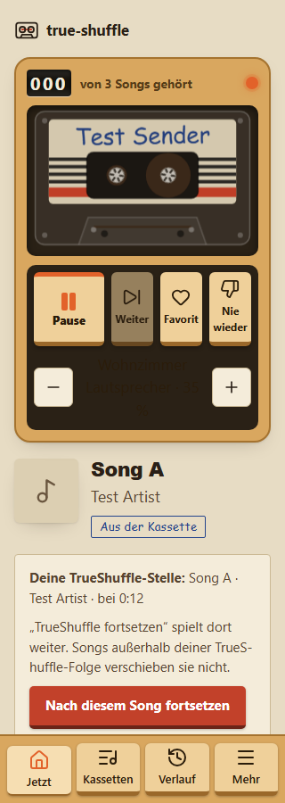
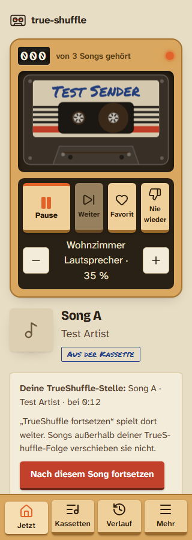

# 1.3.0: Reparatur der PR35-Befunde (lokal)

Stand: 08.11.2026, Branch `fix/1.3.0-pr35-blockers`, nur lokal (nicht gepusht, nicht deployt, kein Release).
Basis `30795cb` (`release/1.3.0`, App-Code identisch mit Produktion `9341e0d`).
Befunde aus PR #35 (`codex/review-1-3-0-9341` @ `684a6fd`, `docs/ai-dev/evidence/pr32-9341-runtime/`); dessen Dateien sind hier unverändert.
Alle Prüfungen mit synthetischen Konten, FakeSpotify und lokalem Worker-Zustand. Kein echtes Spotify, kein Home Assistant, keine Nutzersitzung.

## Befunde, Ursache, Reparatur

| ID | Ursache (reproduziert) | Reparatur | Commit |
|---|---|---|---|
| UI-01 (P1) Verlaufssuche zeigt Konto A unter Konto B | `HistorySearch.load()` gab jede laufende Anfrage zurück, ohne Konto zu prüfen; `forget()` stoppte keine laufende Anfrage; die Seite prüfte `index.account` nicht | Anfrage an Konto und Generation gebunden, späte Antworten werden nicht übernommen; `forget()` beim Abmelden/Kontowechsel (auch bei geschlossener Seite); Treffer und Fehler gehören beim Zeichnen dem Konto und der Anmeldung, die gefragt haben | `cd21df6`, `1f25731` |
| B9341-02 (P1) Manuelle Pause kurz vor Ende startet TrueShuffle | `endReached` rechnete die Zeit seit dem letzten Blick hoch (20 s Spielraum) und ignorierte die echte Position der pausierten Beobachtung | Ende nur, wenn Spotify es zeigt: am Songende (≤ 2 s davor) oder auf 0 zurückgesetzt, nachdem der Song sicher vorbei sein muss; ein neuer Song, dessen Fortschritt zur Zeit seit dem vorhergesagten Ende passt (Crossfade bis 12 s); kein Player bricht ab statt zu starten | `717d151`, `1f25731`, `088aaa6` |
| B9341-01 (P2) Likes doppelt nach 500/429 | Fortschritt nur lokal gezählt und erst nach dem ganzen Schritt gespeichert; die Wiederholung schickte bestätigte Anhängungen erneut | Stand nach jedem bestätigten Schreiben (`kv likes_sync_progress`); nach einer Antwort, die nie kam, eine Längenabfrage der Playlist statt blinder Wiederholung; fremde Länge schreibt von vorn; gelöschte Playlist geht in den vorhandenen Neu-Anlegen-Weg | `717d151`, `1f25731` |
| UI-02 (P2) Lautstärke im Tagmodus unlesbar | `.volume__value` erbte die dunkle Tastenschrift auf dem dunklen Fach (1,046:1) | helle Fachschrift wie `.walkman .transport-note`; „35 %“ mit geschütztem Leerzeichen | `eb42655`, `1f25731` |

Zusätzlich behoben (vom Red Team gefunden): ein selbst gewählter Song 15–20 s vor dem Ende wurde bei einem Blick kurz danach abgeschnitten (`088aaa6`; in Produktion bis ~28 s).

## Vorher / nachher

- PR35-Proben unverändert (`backend-review.test.ts`, `history-search-race.review.test.ts`): vorher 5/5 FAIL (1800 statt 1700 Einträge bei 500 und 429; ein `PUT /me/player/play` nach Pause bei 235 000 ms; A-Index unter B), nachher 5/5 PASS (1700/1700 eindeutig; keine Wiedergabe; Pausenposition 235 000 bleibt).
- Strenge Browserprobe `e2e/review/pr35.fixture.ts` (eigene Konfiguration, Client mit synthetischen `/api`-Antworten): vorher 4 PASS / 3 FAIL (UI-01 bei Kontowechsel und bei Ab-/Wiederanmelden, UI-02 Tag 320 px und 1280 px mit 1,046:1); nachher 7/7 PASS (Tag 12,58:1, Nacht 14,89:1, ohne Querüberlauf).
- Neue Regressionstests gegen den alten Code: 13 von 38 der damaligen Testdateien schlagen dort fehl, genau an den Befunden; nach den Red-Team-Folgen weitere 5 Tests, die jeweils am Stand davor fehlschlagen.

 

UI-01: `screenshots/pr35-fix/ui01-account-b-before.png` (unter B steht „Alice private listening“ von A), `ui01-account-b-after.png` (nur „Alice for B“).

## Tests und Gates (Endstand `088aaa6`)

- `npm run typecheck`, `npm run lint`: PASS.
- `npm run test:known`: 1299 PASS, 3 FAIL, die 3 bekannten L2/L7 aus `test/known-failures.json` (PR35-Vergleich historisch: 1277/3; +22 neue Tests).
- Neue Tests: `test/hub/continue-after.test.ts` (+8), `test/hub/likes.test.ts` (+8), `test/client/history-search.test.ts` (+6).
- `npx playwright test -c e2e/review/pr35.config.ts`: 7/7 PASS.
- `npx playwright test` (voller Funktionstest, echter lokaler Worker + FakeSpotify): siehe unten.

Voller Funktionstest, drei Läufe auf diesem Branch (`717d151`+Arbeitsstand, `1f25731`, `088aaa6`): jeweils 145 PASS / 1 FAIL / 9 NOT_RUN, Fehler jedes Mal `history-ratings.spec.ts:283` (die 9 sind serielle Folgetests derselben Gruppe).

### Klärung `history-ratings.spec.ts:283` (Nachtrag 08.11.2026)

- Der frühere Alt-Vergleich im Worktree `scratchpad/before` war ungültig, Ursache gefunden: dessen Pfad ist so lang, dass die Registry-Durable-Object-Datei unter `e2e/.artifacts/state/v3/do/true-shuffle-e2e-Registry/<64 hex>.sqlite-wal` 266 Zeichen hätte (Windows-Grenze 260). Die Datei wird nicht angelegt, `/auth/callback` endet nach 21 ms mit `login=failed`. Im Haupt-Worktree 183 Zeichen, Anmeldung normal. FakeSpotify selbst antwortet dort korrekt (PKCE-Ablauf von Hand geprüft). Keine echten Zugangsdaten beteiligt; die e2e-Konfiguration ist synthetisch und eingecheckt.
- Gültiger Vergleich daher im selben Haupt-Worktree (gleicher Pfad, gleiche Ports, frischer Zustand je Lauf): kleinster aussagekräftiger Teillauf = die sechs Specs bis einschließlich `history-ratings` (`app`, `capture`, `client-playback`, `cto-history-import`, `history-preview`, `history-ratings`). Allein läuft `history-ratings.spec.ts` auf `5e36da0` 12/12 PASS.

| Lauf | Revision | PASS | FAIL | NOT_RUN | fehlgeschlagen |
|---|---|---|---|---|---|
| neu 1 | `5e36da0` (Code `088aaa6`) | 76 | 1 | 9 | `:283` |
| alt 1 | `30795cb` | 83 | 1 | 2 | `:811` |
| neu 2 | `5e36da0` (Code `088aaa6`) | 84 | 1 | 1 | `:844` |

- Alle drei Fehler haben dieselbe Form: 90-s-Timeout beim Warten auf die Zeile eines Seed-Songs auf der ersten Verlaufsseite (60 Zeilen). In den gesicherten Snapshots (alt `:811`, neu `:844`) fehlt der gesuchte Titel auf Seite 1 tatsächlich (nur Live-/Namensvarianten). `:844` scheitert in Zeile 872, vor dem Abmelden, also nicht im von UI-01 geänderten Ablauf.
- Einordnung damals: vorbestehende Abhängigkeit der Testvorbereitung, am alten Stand ebenso. Repariert im Folgeblock (unten).
- Belege: `D:\T3-Dev\ts-evidence\pr35-fix\hr283\` (`*.log`, `*.rev`, `old-prefix-1-results`, `new-prefix-2-results`).

### Reparatur der Seed-Abhängigkeit (`e070599`, nur Testvorbereitung)

Ursache genau: `songs.plain = unique.slice(2, 12)` aus dem ganzen Verlauf (`limit=200`) des geteilten Kontos `mika`. Titel früherer Specs machten Namen mehrdeutig (die Fake-Bibliothek hat nur 128 verschiedene Titel bei 1500 Songs), die gewählten Songs rutschten hinter Zeile 60.

- `e2e/fake-server.ts`: `/__control/listener?id=` legt einen synthetischen Hörer an (Playlists mit einem Song pro Titel, 128) und macht ihn zum Anmelde- und Steuerziel. `mika` behält Songs, Playlist-IDs P101–P106, Inhalte, Reihenfolge und Likes; einzig seine Geräte sind jetzt Kopien gleicher Werte.
- `e2e/history-ratings.spec.ts`: eigener Hörer `e2e-ratings` (`beforeAll`), danach zurück auf `mika` (`afterAll`). Auswahl aus den neuesten 40 Zeilen; `unique[2..3]` bleiben frei für R-HUI-02; Vorbedingungen: eigenes Konto, ≥ 14 Kandidaten, jeder gewählte Song auf Seite 1 (`limit=60` wie die App) mit 10 Zeilen Reserve. Die Tests der früheren `:283/:811/:844` (jetzt `:331/:859/:892`) sind im Inhalt unverändert; nichts entfernt, abgeschwächt, übersprungen oder verlängert. Kein Produktcode geändert.

| Lauf | Stand | Exit | PASS | FAIL | NOT_RUN | Seed-Positionen |
|---|---|---|---|---|---|---|
| `history-ratings` allein, Zwischenstand v1 | Arbeitsbaum | 0 | 12 | 0 | 0 | 1…26 |
| sechs Specs gemeinsam, v1 | Arbeitsbaum | 0 | 86 | 0 | 0 | 1…38 |
| voller Lauf, v1 (Nebenwirkung auf `mika`) | Arbeitsbaum | 0 | 155 | 0 | 0 | 1…39 |
| `history-ratings` allein ×3, v2 (Bibliothek titel-eindeutig) | Arbeitsbaum | 1/1/1 | 8 | 1 (R-HUI-02) | 3 | 1, 5…14 |
| `history-ratings` allein ×3, v3 (`unique[2..3]` frei) | Arbeitsbaum = `e070599` | 0/0/0 | 12 | 0 | 0 | 1, 7…16 (identisch) |
| sechs Specs gemeinsam, v3 | Arbeitsbaum = `e070599` | 0 | 86 | 0 | 0 | 1, 7…16 |
| voller Lauf | `e070599` | 0 | 155 | 0 | 0 | 1, 7…16 |
| typecheck / lint / test:known | `e070599` | 0/0/0 | 1299 | 3 bekannt (L2/L7) | – | – |

Unabhängig (frischer Prüfer, statisch, kein Playwright): v1 NOT_READY (F1: 40-Zeilen-Fenster machte den Seed nach Modell in ~1/7–1/5 der Läufe rot, wegen wiederholter Titel; F2: Positionsgrenze zu knapp). Nach v3: READY_WITH_NON_BLOCKING_FINDINGS, F1/F2 behoben, `mika` unverändert bis auf Geräte-Kopien. Rest: ob Entdeckungs- oder Like-Songs in die ersten ~69 Wiedergaben des neuen Hörers kommen, ist nicht nachverfolgt; abgesichert nur durch 5 identische Läufe und die 14-aus-40-Marge, ein Fehlschlag wäre eine klare Meldung statt Timeout.
Belege: `D:\T3-Dev\ts-evidence\pr35-fix\hr-isolation\` (`change*.diff`, `alone-1.log`, `six-1.log`, `full-1.log`, `v2-alone-*.log`, `v3-alone-*.log`, `v3-six-1.log`, `full-e070599.log`, `*-e070599.log`).

## Unabhängige Nachprüfung

Frischer Red-Team-Agent ohne Implementierungsanteil, eigener Worktree, eigene Proben.
- Runde 1 (`eb42655`): NOT_READY. Neu: P2 Crossfade-Regression durch eine zu enge Toleranz (5 s), P3 Likes hingen nach verlorener Antwort plus gelöschter Playlist, P3 ein Frame alte Treffer, P3 „%“-Umbruch. Alle behoben in `1f25731`.
- Runde 2 (`1f25731`): READY_WITH_NON_BLOCKING_FINDINGS, alle vier PR35-Befunde behoben. Neu gemeldet: der T3-Abschneidefall, behoben in `088aaa6`. Dieses Urteil deckt `088aaa6` nicht ab.
- Runde 3, eng auf `088aaa6` (frischer Agent, nur Fortsetzen-Entscheidung, vorhandene Proben plus Gegenproben): READY_WITH_NON_BLOCKING_FINDINGS.
  - Selbst gewählter Song 12,5–25 s vor dem Ende, mit/ohne/spätem Blick: 54/54 kein Schnitt (an `1f25731` 32/54 abgeschnitten).
  - Manuelle Pause 5 s/30 s vor dem Ende, mit Player-Verschwinden, mit/ohne Autoplay: 12/12 kein Start.
  - Crossfade 1–12 s, planmäßiger/mittlerer/später Blick: genau ein Fortsetzen (Kontrolle natürliches Ende im selben Lauf).
  - Natürliches Ende ohne/mit Autoplay: keine Regression gegenüber `1f25731`. `test/hub/continue-after.test.ts` 15/15.
  - Neu, P3, Regression in die sichere Richtung: **N1** 10–12-s-Crossfade mit leicht verspäteter Spotify-Position (0,3–3 s) bricht ab statt fortzusetzen (`hub.ts` `sinceEnd`/`justBegan`); **N2** Vorspulen in B ohne gesehenen Blick, Blick 5 s vor dem vorhergesagten Ende: Abbruch statt Fortsetzen. Beide spielen nie ungewollt. Nicht behoben (jede Änderung bräuchte eine neue Prüfung); Vorschlag Red Team: 1–2 s Zusatztoleranz, Pick ab 13 s bleibt ungeschnitten.
  - Belege: `D:\T3-Dev\ts-evidence\pr35-fix\redteam-088aaa6\`.

## Belegte Reichweite (Stand `e070599`, Produktcode `088aaa6`)

Belegt ist: die vier PR35-Befunde und die Red-Team-Folgen sind in FakeSpotify-/Client-Proben behoben; auf `e070599` typecheck/lint 0, Unit/Worker 1299 PASS / 3 bekannte FAIL, voller lokaler Browserlauf 155/155 (Exit 0), PR35-Browserprobe 7/7 (auf `088aaa6`); Produktcode unabhängig geprüft bis `088aaa6`, Testisolation unabhängig geprüft, beide READY_WITH_NON_BLOCKING_FINDINGS. Nicht belegt: echtes Spotify, iPhone, HA/MA, Produktion, CI. Keine pauschale „keine Regression“: N1/N2 (P3, sichere Richtung) bestehen.

## Offen (nicht durch diesen Block entschieden)

- P2, schon in Produktion: Pause, dann „Zurück“ (Song pausiert bei 0) bzw. Pause, dann „Weiter“ (nächster Song pausiert bei 0) startet TrueShuffle. Für den Hub sieht das genauso aus wie ein natürliches Ende ohne Autoplay. Unterscheidung braucht Live-Belege (z. B. recently-played); als eigener Befund zu führen.
- P3, durch `088aaa6`, sichere Richtung: N1 (langer Crossfade mit verspäteter Position) und N2 (unbemerktes Vorspulen) brechen ab statt fortzusetzen.
- P3, schon in Produktion: B unbemerkt pausiert oder zurückgespult, dann ein Song 25 s vor dem tatsächlichen Ende gewählt: wird abgeschnitten (P5 Red Team).
- Browser: Seed-/Seitenabhängigkeit in `history-ratings` behoben (`e070599`); offen nur der nicht nachverfolgte Einfluss von Entdeckungs-/Like-Songs auf den Seed des neuen Hörers (siehe oben).
- P3, ausfallsicher: Spotify lange nicht lesbar nach einem Crossfade-Ende, Weiterspielen nach ungesehener Pause, Vorspulen: bricht ab statt fortzusetzen (Meldung „Du hast selbst …“ ist dann ungenau).
- Live-Crossfade/Automix-Zeiten, echtes Spotify-Verhalten bei 5xx, physisches iPhone, HA/MA, Produktion: NOT_RUN.
- PR31-STORAGE-CLASSIFICATION, D7/`rated:0`, P9/P11/P12/P15: nicht angefasst.
- Versionsnummer/Release-Eintrag: noch nicht angelegt.

## Release-Pfad (mika-app-version-updates, Stand 08.11.2026)

Reguläre TrueShuffle-Arbeit, kein Fork-Experiment. Nächster Schritt im 1.3.0-Plan: Patch-Release **1.3.1** aus diesem Zweig.
1. Version in `package.json` auf 1.3.1 und `RELEASE` in `src/shared/release.ts` (Datum, bis 4 Zeilen „Was ist neu“, `known` um N1/N2 und Pause-Zurück/Weiter ergänzt), Gates auf diesem SHA neu.
2. Unabhängige Prüfung genau dieses Release-SHAs (Diff `30795cb..`; Teilprüfungen bis `088aaa6`/`e070599` liegen vor).
3. CI: auf Owner-Anweisung bis 01.12. kein Wartegrund; ersetzt durch die lokalen Gates und als NOT_RUN ausgewiesen.
4. Migration: keine (nur neuer kv-Schlüssel `likes_sync_progress`, rückwärtsverträglich). Rollback: vorherige Cloudflare-Version `467a9df2` (1.3.0) per `wrangler rollback`.
5. Push des Branches, PR nach `release/1.3.0`, Merge, Fast-Forward des Produktionsbranches, `wrangler deploy --keep-vars` (Workers Builds scheitert, P15).
6. Live-Check: `/api/health` meldet 1.3.1 und neue Build-ID, kurzer Rauchtest der geänderten Wege ohne Schreibaktionen am echten Konto.

Kleinster verbleibender Freigabeblocker: Schritte 5–6 brauchen Mikas ausdrückliche Release-Freigabe für diesen Stand (AGENTS.md: kein Push/Merge/Deploy auf `main` oder den Produktionsbranch ohne sie) und für den Deploy die vorhandene Cloudflare-Anmeldung; Schritte 1–2 sind ohne neue Freigabe lokal machbar.
